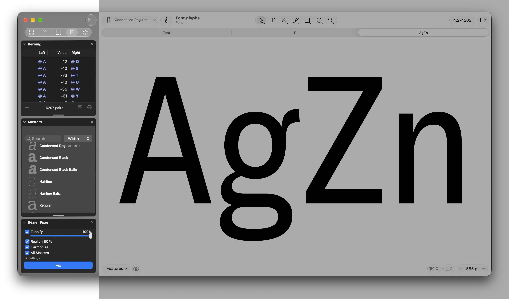

  

<h1 align="center">AZ Docker</h1>

  <strong>Dock your floating windows in your sidebar.</strong>

  <a><picture>
    <source media="(prefers-color-scheme: dark)" srcset="https://img.shields.io/badge/Free_Plugin-6690e3">
    
  </picture></a>
  <a href="https://azerty-typefaces.com"><picture>
    <source media="(prefers-color-scheme: dark)" srcset="https://img.shields.io/badge/More_AZ_plugins-242424">
    
  </picture></a>

---

   

AZ Docker is a [GlyphsApp](https://glyphsapp.com/) plugin that adds a tab to the left sidebar of the Edit view. Drag any floating window onto it, a plugin palette, the Kerning window, a script's window, and its content moves into the sidebar, stacked with the others and still fully usable. The canvas stays clear, and hiding the sidebar hides every docked window at once.

 

## Getting started

1. Install AZ Docker : [Install in Glyphs 4](https://azerty-typefaces.github.io/AZ-Docker/install.html)

   Or open *Window ▸ Plugin Manager*, find **AZ Docker** and click *Install*.
2. Restart Glyphs.
3. Open a glyph in an Edit tab, show the left sidebar and click the **AZ Docker** tab.
4. Open any floating window and drag it by its title bar over the sidebar. The sidebar outlines in blue and the window docks while you still hold the mouse.

 

## Feedback

Bugs and ideas go to the [issue tracker](https://github.com/azerty-typefaces/AZ-Docker/issues).

 

## Credits

Copyright © 2026 [Hugo Jourdan](https://azerty-typefaces.com). All rights reserved.

Made possible with the GlyphsSDK by Georg Seifert (@schriftgestalt) and Rainer Erich Scheichelbauer (@mekkablue).
